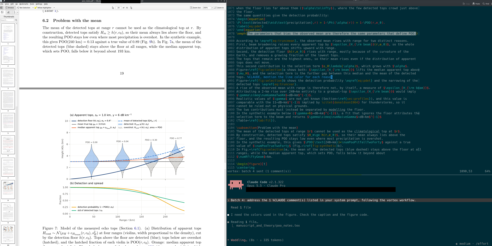

# vortex

**Co-write a LaTeX document with Claude Code without leaving vim, and keep
editing while Claude works.**

> [!IMPORTANT]
> **This project is entirely vibecoded.** Every line of code, configuration
> and documentation in this repository, this README included, was written by
> Claude (Anthropic's Claude Code, model Claude Opus 5.5) in conversation with
> its human author. The author described the workflow they wanted, tried each
> version and asked for changes. They did not write or review the code line by
> line. It has been used and tested on a single Linux machine. Read it before
> you trust it with your work. Git keeps every version of your document (see
> below), but there are no guarantees.

> 📷 **Screenshot needed: `docs/screenshots/overview.png`.** The whole
> terminal: vim in the top two thirds with a few `%CLAUDE` comments visible,
> Claude working in the bottom third, and okular showing the PDF next to it.

<!--  -->

## Why

Editing a paper with an AI assistant usually goes like this: read the PDF,
write a handful of comments, hand them over, then **wait** until the assistant
is done before you can touch the file again. vortex removes the wait:

1. You read the PDF and leave comments in the source: `%CLAUDE reformulate to avoid repetition`.
2. `:vb` sends the batch of comments to Claude, which runs in the bottom of the
   same terminal.
3. You keep reading and editing. Claude works on its own copy, in a git worktree.
4. When Claude is done, its changes are merged with yours. Vim reloads with
   your cursor on the same text, and latexmk rebuilds the PDF.

Every step is a git commit, so nothing is ever lost.

## Features

### One terminal, three parts

`vortex start paper.tex` opens a tmux session with:

- **vim** on the document, in the top two thirds;
- **Claude Code** in the bottom third while a batch runs, or a status line when idle;
- **latexmk -pvc** in a second tmux window, which opens **okular** and keeps the
  PDF up to date as you save.

`Ctrl-w w` (also `W`, `j`, `k`) moves between the vim windows and the Claude
pane the same way it moves between vim windows. `:wq` closes everything and
returns to the shell. `:nok` opens a second okular window, handy for keeping a
figure in view while you read the text that discusses it.

vortex runs its own tmux server (`tmux -L vortex`) and loads its vim plugin
from the command line, so your own tmux and vim configuration are left alone.

### Batches of comments

Write comments anywhere in the source as `%CLAUDE <instruction>`, then type
`:vb`. vortex:

- saves all your buffers (it refuses to start if one can't be saved);
- commits your current state;
- starts a **fresh** Claude Code session in the bottom pane, so every batch
  starts with an empty context;
- gives Claude the list of comments, so it doesn't have to search the
  document for them.

Claude addresses each comment and deletes it. When a comment is unclear, it
leaves it in place, adds a `%CLAUDE-Q <question>` line below it and asks you
in its pane.

> 📷 **Screenshot needed: `docs/screenshots/comments.png`.** vim showing a
> paragraph with two or three `%CLAUDE` comments, just before typing `:vb`.

### Keep editing while Claude works

Claude never touches your file directly. It works in a private git worktree in
`.vortex/worktree/`, so its half-finished edits never reach your copy or
latexmk. When Claude is done it runs `vortex submit`, which:

1. waits until vim is in **normal mode**, so it never interrupts typing;
2. saves your buffers and briefly makes them read-only;
3. commits your edits made meanwhile, then merges them with Claude's commit;
4. fast-forwards your branch to the merge, which updates your file on disk;
5. reloads vim **with the cursor on the same text**, even when Claude added or
   removed lines above it;
6. lets latexmk rebuild the PDF.

`u` in vim undoes the whole merge, because vim keeps its undo history across
the reload.

```
your branch     ●───────────────●──────────────●  (fast-forward)
  snapshot       \     your edits meanwhile    /
                  \                           /
vortex/claude      ●── Claude's edits ──●── merge
```

### Conflicts are resolved by Claude, or by you

If you and Claude changed the same lines, the merge stops with a conflict and
Claude resolves it: your edits are kept and Claude's intent is re-applied on
top. If the two contradict each other (you both rewrote the same sentence
differently), Claude asks you in its pane which version to keep.

> 📷 **Screenshot needed: `docs/screenshots/conflict.png`.** The Claude pane
> asking which version of a sentence to keep after a conflict.

### Everything is a commit

Your snapshots, Claude's edits and every merge are commits tagged
`Vortex-Batch: N`. Claude's commits are authored as `Claude (vortex)`, so
`git blame` shows who wrote what. `vortex log` (`:VortexLog` in vim) lists them.

Snapshots commit every tracked file you changed in the document directory,
plus the document files listed in `.vortex/config`, even if new. Untracked
files and anything outside the document directory are never committed.

> 📷 **Screenshot needed: `docs/screenshots/log.png`.** The output of
> `vortex log` (or `git log --graph`) after a few batches.

### You control Claude's context

Claude Code normally loads `CLAUDE.md` files, memories and so on. vortex
replaces most of that with an explicit list of Markdown files, joined into
the system prompt. The pane prints that list at the start of each batch:

- `context/workflow.md`: how a batch works (the protocol Claude follows);
- `context/writing.md`: writing preferences;
- `context/latex.md`: LaTeX preferences (e.g. one sentence per line, lines of
  about 100 characters);
- `context/coding.md`: coding preferences, read only before Claude changes code;
- `.vortex/project.md`, per document: notes about the document (structure,
  notation, settled decisions), so Claude doesn't have to re-read and
  re-interpret it for every batch.

Which modules are loaded is set per document in `.vortex/config`. Claude Code's
auto-memory is turned off for vortex sessions.

The context files in this repository are the author's own preferences. They
are examples: edit them to match yours.

### Reliable references

`writing.md` requires every reference and DOI that Claude adds or modifies to
be checked online (doi.org or Crossref) or confirmed by you. If Claude can't
verify one, it leaves a red `\todo{unverified reference: key}` next to the
citation and an `% UNVERIFIED` comment in the `.bib` file, so it shows in
the PDF.

### Generated figures

If figures are produced by code, set the command in `.vortex/config`, e.g.
`figures = make figures` and `figure_inputs = code`. Before compiling,
`vortex check` regenerates the figures, but only if Claude changed something in
`figure_inputs`. It sets a fixed `SOURCE_DATE_EPOCH`, so matplotlib figures
that didn't change come out byte-identical and don't create commits.

### Claude checks its own work

Before submitting, Claude compiles its copy with `vortex check` (latexmk into
`.vortex/build/`) and fixes the errors it introduced.

### Nothing outside the project

Everything vortex writes for a document lives in `<docdir>/.vortex/`. That
folder ignores itself in git, except `config` and `project.md`, which you may
commit. vortex itself writes nothing in your home directory. Claude Code still
keeps its own session transcripts in `~/.claude`.

## Requirements

Tested on Ubuntu 22.04 with:

- Python 3.8 or newer (standard library only; tested with 3.10)
- vim 8.2 with `+job +channel +timers` (not Neovim)
- tmux 3.2 (older versions untested)
- git with worktree support (tested with 2.34)
- latexmk and a TeX distribution
- okular (opened by latexmk and by `:nok`)
- [Claude Code](https://docs.claude.com/en/docs/claude-code) (tested with 2.1.322), logged in

## Install

```sh
git clone <this repository> vortex
ln -s "$PWD/vortex/bin/vortex" ~/bin/vortex   # any directory on your PATH
```

## Quick start

```sh
vortex start path/to/paper.tex
```

The first start creates `path/to/.vortex/` with a `config` and a `project.md`
template. Fill in `project.md` with a few lines about the document, then
write `%CLAUDE` comments and type `:vb`.

The document must be in a git repository, on a branch (not a detached HEAD).

## Commands

In vim:

| Command | What it does |
|---|---|
| `:vb`, `:VortexBatch` | send the `%CLAUDE` comments to Claude |
| `:VortexStatus` | current state, and the context files loaded for the last batch |
| `:VortexAbort` | cancel the running batch |
| `:VortexLog` | list the vortex commits |
| `:nok`, `:NewOkularWindow` | open an extra okular window on the PDF |
| `Ctrl-w w` / `W` / `j` / `k` | move between vim windows and the Claude pane |
| `:wq` (last window) | close the whole session |

In the shell (`vortex -h`):

| Command | What it does |
|---|---|
| `vortex start file.tex` | open the session (creates `.vortex/` if needed) |
| `vortex init file.tex` | only create `.vortex/` |
| `vortex batch` | same as `:vb` |
| `vortex status` / `log` / `abort` | as in vim |
| `vortex check` | regenerate figures if needed and compile Claude's copy (used by Claude) |
| `vortex submit -m "..."` | merge Claude's work into your copy (used by Claude) |

In the Claude pane, `Alt-Up` / `Alt-Down` also move between panes.

## Configuration

`<docdir>/.vortex/config`:

```ini
[vortex]
# main LaTeX file
main = paper.tex
# document files: scanned for %CLAUDE tags, committed even when new
files = paper.tex references.bib
# context modules, from <vortex>/context/<name>.md (project.md is always added)
context = workflow writing latex
# extra arguments for claude, e.g. --model opus
claude_args =
# regenerate figures when Claude changes figure_inputs (empty: no figures)
figures = make figures
figure_inputs = code
```

## What Claude is allowed to do

Each batch runs Claude Code with `--permission-mode acceptEdits` inside its
worktree, plus a generated settings file that:

- **allows without asking:** `vortex check`, `vortex submit`, read-only git
  commands, `git add`, `grep`, web search, and fetching from `doi.org` and
  `api.crossref.org`;
- **denies:** editing your copy of the `.tex`/`.bib` files and the context
  modules.

Anything else (other shell commands, other websites) asks for your approval in
the Claude pane.

## Repository layout

```
bin/vortex          the tool (Python, standard library only)
vim/vortex.vim      vim side: commands, save/lock/reload, Ctrl-w navigation
tmux/vortex.conf    config of the private tmux server
context/*.md        context modules for Claude
```

## Known limitations

- Tested by one person on one machine. Expect rough edges elsewhere.
- Merges are line-based. Keeping one sentence per line (as `latex.md` asks)
  keeps conflicts rare.
- Quitting vim during a batch stops Claude. Its unfinished work stays in the
  worktree until the next batch resets it.
- Your global `~/.claude/CLAUDE.md` is still loaded by Claude Code.
- okular is hard-coded as the PDF viewer.

## License

MIT, see [LICENSE](LICENSE).
